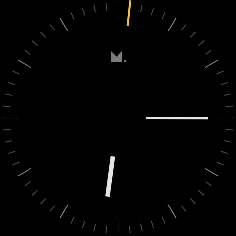
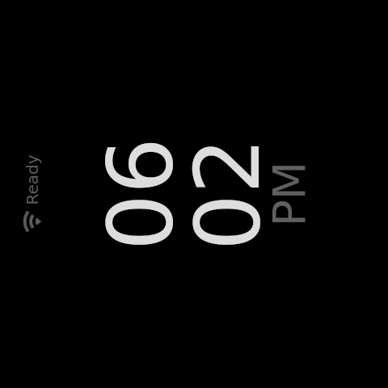

# Screen-off validation

This change implements sustained screen off, not system standby or a measured
power target. The SoM, network and ESP32 continue running.

## Comparable UI evidence

The real IdleScreen and IdleTimerProvider were rendered at 480 × 480 with the
same simulated clock, settings and backlight API. Both captures are at the
existing five-minute idle deadline plus ten minutes on the clock screen.
These are component screenshots, not photographs of the physical backlight.

| Beta before this change                                             | Candidate                                                                      |
| ------------------------------------------------------------------- | ------------------------------------------------------------------------------ |
|  |  |

## Regression evidence

`npm run test:idle-screen` exercises five clock variants, manual and automatic
entry, twenty minutes without relighting, wake to full brightness and cancellation
of the old timeout when idle is left. Expected values come from the existing
five- and ten-minute timers and the backlight API's 0–1 range.

Restoring beta's IdleScreen and DigitalClock makes the automatic test fail:
at fifteen minutes the latest requested brightness is 0.33 instead of 0.
Restoring DigitalClock alone makes the digital test reject its extra full-brightness
request while entering screen off. Candidate sources are restored after each
mutation and the suite is rerun.

Four additional menu tests mount the production QuickSettings, SocketManager,
SocketProviderValue, IdleTimerProvider and IdleScreen. Only the transport and
unrelated machine/catalog boundaries are substituted. Starting with the quick
menu open, clockwise input selects Screen off; ENCODER_PRESSED, RELEASED and
PUSH are delivered separately and in one browser turn, with analog and digital
clocks. The press tail must keep brightness at zero; a later counterclockwise
event must restore it to one. The menu must close and no machine action may be
sent. Outer routing is reduced; this does not replace physical input validation.

Planting a reset of idle on `pressUp` makes the new menu test fail while all eight
original idle tests still pass. The mutation was removed; all twelve tests pass.

The existing scale-overlay component suite, unit tests, formatting, types, lint,
production frontend build, CI test-file coverage and backend contract are also
checked. All six PR CI jobs and the separate integration/e2e check passed for
product commit `b9093ea18fa332fd674d9bc49c6d805276a1dcc1`.

## Installed ARM64 preview

The [standalone package build](https://github.com/MeticulousHome/meticulous-dial/actions/runs/39336681626)
completed successfully. Build commit `2cc1c52dd304b98f913fa5fff68891f190048169`
contains the same product tree as `b9093ea18fa332fd674d9bc49c6d805276a1dcc1`,
plus the preview build workflow. It produced a Dial `.deb`, not a machine image.

| Artifact                             | SHA-256                                                            |
| ------------------------------------ | ------------------------------------------------------------------ |
| `meticulous-dial_0.1.0_arm64.deb`    | `ed7ea9b7f047bb2211a16368a90d2082aa34deaa1063fc7d61867791fe8abbc8` |
| Installed `/usr/bin/meticulous-dial` | `d2612e4782596af4b70c6f4d732cf5d59375d06d4978f0ac0f1c054ea5d8b721` |

On the USB-correlated dedicated machine, package metadata, shared-library
resolution and a simulated package installation passed before installation.
Only the Dial binary differed from the installed package files. The original
binary and package metadata were backed up before installing the preview.
The service started at 16:57:33 on 2026-10-19 (UTC−06:00); React reported ready
at 16:57:37 and the profile home screen at 16:57:42.

## Automatic entry on the dedicated machine

The real driver brightness was sampled once per second without operating the
menu or changing the idle settings. With the installed digital clock selected:

| Local time, 2026-10-19 (UTC−06:00) | Observation                                         |
| ---------------------------------- | --------------------------------------------------- |
| 16:58:04                           | Driver brightness 100, maximum 100                  |
| 17:02:39–17:02:40                  | Animated transition from 100 to 33; clock visible   |
| 17:12:38–17:12:39                  | Animated transition from 33 to 0                    |
| Following 65 seconds               | Every one-second sample remains at 0; no relighting |

`actual_brightness` also read 0. The 480 × 480 compositor capture taken at
17:12:45 contains only black RGB pixels. These are unmodified compositor
captures from the machine, not photographs or a measurement of emitted light.
The clock capture retains the compositor's rotation; the physical panel handles
its orientation.

| Clock screen                                                 | Automatic screen off                                              |
| ------------------------------------------------------------ | ----------------------------------------------------------------- |
|  |  |

Physical menu navigation and physical wake remain unvalidated. Neither the
component suite nor a real backlight reading establishes watts or compliance.
